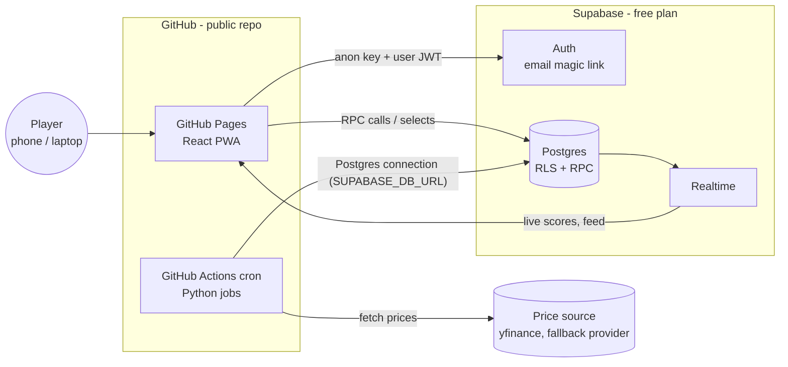
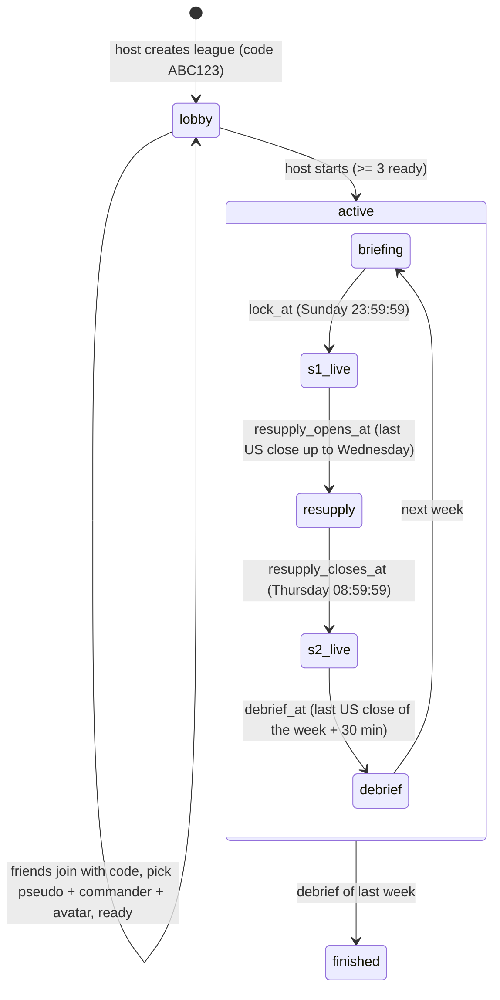

# ARCHITECTURE.md

## 1. Goals and constraints

- 3–5 friends per league, several leagues possible. UI in English and French, Europe/Paris time.
- Public GitHub repository, **zero running cost**, no server to maintain.
- Mobile-first: players mostly check on their phone (PWA, "add to home screen").
- Scores update every ~15 minutes during market hours. Not real-time trading.

## 2. Overview



| Piece | Choice | Why |
|---|---|---|
| Frontend | Vite + React + TS, PWA, GitHub Pages | Static hosting is free; Pages deploys from Actions |
| Auth + DB + realtime | Supabase (free plan) | Postgres with RLS, magic-link auth and realtime in one free service |
| Scheduled work | GitHub Actions cron | Free for public repos on standard runners; Python ecosystem for market data |
| Game maths | Python `engine/` package | One tested implementation, used by jobs and the replay tool |

### Platform facts to design around (checked Oct 2026)

- GitHub Actions is free for public repositories on standard GitHub-hosted runners.
- In a public repo, **scheduled workflows are disabled after 60 days without repository
  activity**. A campaign lasts up to 10 weeks → add a weekly `heartbeat` workflow that
  commits `status/heartbeat.json` (timestamp only, no league data).
- Scheduled runs can start late under load. The tick is time-based and idempotent; every
  workflow also has `workflow_dispatch` for manual runs.
- Supabase free projects are **paused after ~7 days of low database activity**. The tick
  writes to the database every 15 minutes on weekdays, which keeps it active; a weekend
  ping in the hourly weekend tick covers the gap.
- Supabase's **built-in email service only delivers to members of the project's
  organization team, at about 2 emails per hour**. Friends cannot log in until a custom
  SMTP provider is configured (SETUP.md step 3).
- Supabase **Realtime `postgres_changes` works on tables only** (views cannot be added to
  the `supabase_realtime` publication), and RLS filters whole rows, not columns. Anything
  that must be partly masked live is written already masked to its own table by the job.
- `yfinance` is unofficial and Yahoo often rate-limits datacenter IPs such as GitHub
  runners (HTTP 429). A fallback provider is required from milestone 03, not "later".
- iOS opens a magic link in Safari, not in the installed home-screen PWA (separate
  storage), so the login also offers a 6-digit email code typed in the app.

## 3. Repository layout

```
.
├── CLAUDE.md
├── .gitattributes         `* text=auto eol=lf`
├── docs/                  GAME_RULES.md, ARCHITECTURE.md, SETUP.md (later PLAYTEST.md)
├── prompts/               00…09, one prompt per milestone
├── data/instruments.csv   catalogue seed
├── web/                   React PWA
│   └── src/{app,pages,components,lib,i18n,content,config.ts}
├── supabase/
│   ├── migrations/        schema, RLS, RPC (SQL)
│   ├── scripts/           generators (e.g. seed SQL from the CSV and engine/config.py)
│   ├── seed.sql           instruments, game_config (generated)
│   └── tests/             RLS / RPC tests (pgTAP or SQL scripts)
├── engine/                Python package: pure game logic + calendars
│   ├── engine/{config,models,scoring,commanders,orders,ranking,feats,calendar,conflict_zone,weather,drone,simulate}.py
│   └── tests/
├── jobs/                  tick.py, prices.py, replay.py, dispatch.py, db.py
├── status/heartbeat.json
└── .github/workflows/     ci.yml, deploy-pages.yml, tick.yml, heartbeat.yml

`engine/config.py` in the docs means the module `engine/engine/config.py`.
```

## 4. Data model (Postgres)

Enums: `league_status(lobby, active, finished)`,
`phase(briefing, s1_live, resupply, s2_live, debrief)`,
`slot(champion, veteran, marksman, saboteur, priority_target, reserve_1, reserve_2, reserve_3)`,
`commander(bastion, berserker, prophet, hunter, shadow, technomancer, quartermaster)`,
`order_type(...)`, `order_window(briefing, resupply)`,
`order_status(pending, applied, blocked, rejected)`,
`pact_status(proposed, active, declined, cancelled)`.

**Players are league members, not users.** Every player-scoped table references
`league_members.member_id`. The Drone is a member with `user_id = null` and
`is_drone = true`, so it has squads and scores like everyone else without an auth account.

| Table | Key columns |
|---|---|
| `profiles` | `id` (= auth.users.id), `locale` (`en`/`fr`), `created_at` |
| `leagues` | `id`, `name`, `invite_code` unique, `host_id`, `status`, `max_players` 3–5, `campaign_weeks`, `drone_enabled`, `start_week` (Monday date) |
| `league_members` | `member_id` pk, `league_id`, `user_id` (null for the Drone), unique (`league_id`, `user_id`), `pseudo`, `commander`, `avatar_color`, `ready`, `is_drone` |
| `instruments` | `id`, `ticker`, `name`, `region`, `calendar_mic`, `currency`, `sector` (code) |
| `instrument_weeks` | (`instrument_id`, `week`), `vol12w`, `coef`, `display_class`, `prev_week_return`, `max_abs_daily_move_prev`, `market_cap`, `earnings_date`, `in_conflict_zone`, `weather` text[] — global, the same for every league |
| `reference_prices` | (`instrument_id`, `week`, `kind` p0/p_mid/p_end), `price` (unadjusted), `dividend`, `split_ratio`, `source`, `fetched_at`, `confirmed` |
| `prices_live` | (`instrument_id`, `ts`), `price` — pruned after 14 days |
| `weeks` | (`league_id`, `week`), `number`, `phase`, `is_final`, `lock_at`, `resupply_opens_at`, `resupply_closes_at`, `debrief_at` (UTC, from `engine/calendar.py`), `phase_changed_at` |
| `squads` | (`league_id`, `week`, `member_id`), `locked`, `auto`, `submitted_at` |
| `squad_units` | (`league_id`, `week`, `member_id`, `slot`), `instrument_id`, `active_s1`, `active_s2` |
| `swaps` | `id`, `league_id`, `week`, `member_id`, `slot`, `reserve_slot`, `created_at` — pending until `resupply_closes_at` |
| `ammo_ledger` | `league_id`, `member_id`, `week`, `delta`, `reason` (view `ammo_balance`) |
| `orders` | `id`, `league_id`, `week`, `member_id`, `type`, `target_member_id`, `target_slot`, `order_window`, `cost`, `status`, `created_at`, `resolved_at` (`window` is a reserved word in Postgres: never use it as a column name) |
| `pacts` | `id`, `league_id`, `week`, `proposer_member_id`, `partner_member_id`, `status` |
| `scores_live` | (`league_id`, `week`, `member_id`), `pf_live`, `units` jsonb, `updated_at` — **private**: owner only, and only when not jammed |
| `scores_live_public` | (`league_id`, `week`, `member_id`), `pf_live` (null when jammed), `rank_live` (null when jammed), `jammed`, `units` jsonb (masked), `updated_at` — written **already masked** by the job; no row for a Shadow; this is the table clients subscribe to with Realtime |
| `scores_final` | (`league_id`, `week`, `member_id`), `pf_total`, `pf_picking`, `breakdown` jsonb, `rank`, `campaign_points` |
| `badges` | `league_id`, `week`, `member_id`, `code` |
| `events` | `id`, `league_id`, `week`, `ts`, `kind`, `template_key`, `vars` jsonb, `variant`, `audience` (all / member id) — rendered client-side in the reader's language. An `intel` snapshot is an event with the attacker as audience |
| `game_config` | key/value generated from `engine/config.py`. **Runtime source for RPC validation** (costs, caps, credits, swaps…) and for display. A CI test fails if it differs from `engine/config.py` |
| `market_runs` | unique (`week`, `transition`), `ran_at` — idempotence of global market transitions |
| `job_runs` | unique (`league_id`, `week`, `transition`), `league_id` **not null**, `ran_at` — idempotence of league transitions |
| `market_sessions` | (`mic`, `session`), `open_at`, `close_at` — the week's sessions from `exchange_calendars`, written by the market job; the app's daily phase banner reads them (no market hours in the frontend) |
| `system_status` | one row: `last_tick_at`, `last_tick_ok`, `last_success_at`, `consecutive_failures`, `prices_updated_at`, `dev_clock` — written by `jobs/tick.py` |
| `private.tick_runs` | one row per tick: `game_time`, `ok`, `done`, `log` (the tick's log lines), `error` — not exposed to the API (docs/DEV.md) |
| `private.dev_clock` | local dev only: the simulated time every session uses (docs/DEV.md); never present in production |

Read-only views besides those above: `live_returns` (each instrument's move this week,
last live quote or final P_end against P0, for display next to units).

## 5. Security model (public repo)

**Clients have no INSERT/UPDATE/DELETE on any game table.** All writes go through RPC
functions (`security definer`, `set search_path = ''` with schema-qualified names) that
check auth, membership, deadlines and game rules, then write.

RPC functions: `create_league`, `league_preview(code)` (read-only: name, state, host, seats,
for the join page), `join_league(code)`, `leave_league` (lobby only),
`order_costs(league)` (read-only: what each order costs the caller now, Bounty discount
included), `server_time()` (the clock every deadline uses),
`update_member(pseudo, commander, avatar_color)`, `set_ready`, `start_campaign`,
`set_locale(locale)`, `save_squad(units jsonb)`, `swap_unit` / `cancel_swap`,
`play_order`, `propose_pact`, `accept_pact`, `decline_pact`.

Rules for every database object:

- **Deadlines**: RPCs compare `now()` with `weeks.lock_at`, `resupply_opens_at`,
  `resupply_closes_at`; `weeks.phase` is informative only (the cron can be late).
- **Rule values**: RPCs read `game_config`; no number is hardcoded in SQL.
- **Clock**: every deadline check uses `private.clock()`. It returns `now()`, except that a
  direct database session (tests, `jobs/replay.py`) may set `app.fake_now` (ignored for
  API sessions), and a local database in dev mode has a row in `private.dev_clock` that
  applies to every session (docs/DEV.md). Production never has that row. The app reads
  the same clock through `server_time()` for its countdowns.
- **Errors**: `private.raise_error(code, vars)` raises SQLSTATE `P0001` with the code as
  message and the variables as JSON in `details`; `web/src/lib/rpcError.ts` maps it to the
  `error.<CODE>` i18n key. A test fails if a code has no EN/FR message.
- **Views** run with their owner's rights and bypass RLS unless created with
  `security_invoker = true`. Use `security_invoker` by default; a view that must bypass
  RLS to show masked data (e.g. `orders_public`) filters on league membership of
  `auth.uid()` itself and is covered by the outsider tests.
- **Functions**: Supabase grants EXECUTE to `anon` and `authenticated` by default.
  Internal helpers live in a `private` schema that is not exposed by the API; every
  function gets `revoke execute … from public, anon` and an explicit grant only when it
  is a player RPC.
- **Realtime**: clients subscribe only to tables (`scores_live_public`, `events`,
  `league_members`, `weeks`, `pacts`), never to views, each protected by RLS.
- **Rate limit**: PostgREST calls `private.check_request()` before every API request
  (`pgrst.db_pre_request` on the `authenticator` role, migration 16). It counts each
  user's RPC calls that write (read-write transactions on `/rpc/*`) per minute and refuses
  with `RATE_LIMITED` past `rpc_rate_limit_per_minute`. A refused RPC rolls back with its
  count (no autonomous transactions in Postgres), so the limit bounds the calls that
  write; refused calls write nothing and fail fast. It is the only function `anon` can
  execute (it returns at once without a user).
- **Parameters**: every refusal is a `raise_error` code, never an internal error; the RPC
  fuzz tests (`supabase/tests/test_rpc_fuzz.py`) send garbage to every player RPC and
  fail on any other SQLSTATE.

**Auth**: email magic link with the **PKCE flow** (the code comes back as `?code=…`, which
does not clash with HashRouter's `#/…` routes; the app exchanges it before the router
mounts) plus a **6-digit email code** that can be typed in the app (needed for the iOS
home-screen PWA). Emails go through a custom SMTP provider. A join link opened before
logging in (`#/join/CODE`) is kept in localStorage and reopened after the login.
The sign-up sends the browser language (`options.data.locale`); a trigger copies it to
`profiles.locale`, which then follows the player on every device (`set_locale`).

Read rules (RLS or `security_barrier` views):

| Data | Who can read |
|---|---|
| League, members, weeks, final scores, badges | Members of that league |
| Own squad, own orders, own swaps, own credits (`ammo_ledger`) | Owner, always |
| Other players' squads | Members, from `lock_at`. Shadow's squad: only from `debrief_at` |
| A target's draft before lock | Only through an `intel` snapshot event, audience = the attacker |
| Other players' S2 swaps | From `resupply_closes_at`. Shadow: from `debrief_at` |
| Other players' orders | After resolution, via view `orders_public`: attacker masked when the attacker is a Shadow; `force_field` visible only once triggered |
| `scores_live` (private) | Owner only, and not while jammed |
| `scores_live_public` | Members (rows already masked by the job: no Shadow row, jammed rows without War Points or rank) |
| `events` | Members, filtered by `audience` |
| `profiles` | Own row only |
| `instruments`, `instrument_weeks`, prices, `game_config` | Any authenticated user |

Tests must prove each line of this table with two users and a third outsider.

Secrets: one GitHub Actions secret, `SUPABASE_DB_URL` (Supabase session pooler connection
string, IPv4), used only by the `tick` workflow. The jobs talk to Postgres directly
(psycopg) as the `postgres` role, which bypasses RLS like the service role would, and run
each transition and its `job_runs` / `market_runs` key in one transaction. The string is
never logged or written to a file. `replay` runs by hand against a local or dev database.
CI scans the whole git history for credentials on every pull request
(`tools/scan_history.py`). Workflows never use `pull_request_target` and never expose
secrets to pull-request runs. Frontend build variables `VITE_SUPABASE_URL`,
`VITE_SUPABASE_ANON_KEY` (public by design) as repository variables. Supabase Auth
redirect URL = the Pages URL.

## 6. Jobs and schedules

`jobs/tick.py` is the single entry point (`python -m jobs.tick [--now ISO]`). It first runs the **market transitions**
(global, guarded by `market_runs`), then loads all active leagues, computes the phase
each week should be in **now** from the stored phase timestamps, and performs any missing
**league transition** (guarded by `job_runs`).

Market transitions (once per week for all leagues):

| Transition | When | Work |
|---|---|---|
| `capture_p0` | First open of the week + 10 min, per instrument calendar | Store `P0` |
| `capture_p_mid` | First open on/after Thursday + 10 min, per calendar | Store `P_mid` |
| `capture_p_end` | Last close of the week + `debrief_delay_min`, per calendar | Store `P_end`, re-read once on the next tick and set `confirmed` (flag a mismatch) |
| `week_stats` | After the week's last `P_end` is confirmed | Next week's `instrument_weeks`: `vol12w`, `coef`, display class, market cap, earnings date, Conflict Zone, weather |
| `live_prices` | Every tick during sessions | Batch quotes into `prices_live`, prune > 14 days |

League transitions:

| Transition | When | Work |
|---|---|---|
| `open_briefing` | After debrief / at start | Create the week with its phase timestamps, credit income + catch-up, Bounty |
| `lock` | `lock_at` | Lock squads, auto-squads, resolve briefing orders, Drone squad |
| `open_resupply` | `resupply_opens_at` | Phase change |
| `close_resupply` | `resupply_closes_at` | Apply swaps, resolve resupply orders |
| `live_scores` | Every tick during sessions (not keyed: recomputed each time) | Write `scores_live` and the masked `scores_live_public` from `prices_live` |
| `debrief` | `debrief_at`, once every `P_end` is confirmed | Final scoring, ranks, campaign points, feats, badges, Front Dispatch |
| `dispatch_*` | Monday EU open + 10 min, Thursday 09:10, debrief | Generate dispatch events (template key + vars) |

Workflows:

- `tick.yml`: `*/15` UTC on weekdays 06:00–22:00, hourly on weekends, plus `workflow_dispatch`.
  `concurrency: tick` so two runs never overlap.
- `heartbeat.yml`: weekly commit of `status/heartbeat.json` (keeps the schedule alive).

**Journal.** Every tick is recorded in `private.tick_runs` (transitions done, log lines,
error) and summarised in `public.system_status` (read by the app). See docs/DEV.md §3.

**Failure handling.** A transition and its key are inserted in one transaction: a crash
rolls both back and the next tick retries. A transition whose inputs are not there yet
(no Conflict Zone at lock, `P_end` not confirmed at debrief, prices missing at a capture)
raises `RetryLater`: nothing is written, the next tick tries again. A missing price is
retried for 2 hours, then left missing and logged, except `P_end`: if the provider is down
on Friday night, the last live quote of the week (`prices_live`, an observed price) stands
for it, stored with `source = 'fallback:last_quote'` and shown in the debrief; a
`confirm_p_end` that reads a real close replaces it. `capture_p_end` and `confirm_p_end`
always run on two different ticks. The next week's `open_briefing` runs on the tick after
the debrief.

**Replay** (`python -m jobs.replay --league demo --week 2026-W43 --db URL`): creates a
demo league (4 bots and the Drone) whose first week is the replayed one, then walks a fake
clock (`app.fake_now`, honoured only for direct Postgres sessions) through every
transition of the week, calling the same `tick` with real daily bars cut at the fake
clock. It prints the final ranking and the three Front Dispatches in English and French.
- `ci.yml`: ruff, pytest, eslint, vitest, build on every PR.
- `deploy-pages.yml`: build `web/` and deploy on push to `main`.

**Price source** (`jobs/prices.py`): primary `yfinance` with `auto_adjust=False` (never
adjusted for dividends; the engine adds them back), fallback the Yahoo chart HTTP API
called directly (`query2.finance.yahoo.com/v8/finance/chart`), behind one `PriceProvider`
protocol. Each call retries (2 s, 4 s, 8 s), then falls back per ticker, and the source that
answered is stored. The fallback has no market cap and no earnings dates: reported as
missing, never invented. A provider failure never corrupts reference prices: retry, switch
provider, then mark missing. `python -m jobs.validate_tickers` checks the catalogue;
`python -m jobs.dry_run` fetches one real week into a local JSON file.

## 7. Lobby and game flow



Join link format: `https://<user>.github.io/<repo>/#/join/ABC123`.

## 8. Screens (EN/FR, light theme, mobile-first)

Routes are in English for both languages. A language switch sits in the header.

| Route | Screen |
|---|---|
| `#/` | My leagues + create / join |
| `#/login` | Magic-link login + 6-digit code entry |
| `#/join/:code` | Join a league |
| `#/l/:id/lobby` | Lobby: players, commander, avatar, ready, start |
| `#/l/:id/briefing` | Squad builder, Conflict Zone, briefing orders, pacts |
| `#/l/:id/front` | Live leaderboard, my squad, daily phase, event feed |
| `#/l/:id/resupply` | Swap, resupply orders, credits |
| `#/l/:id/debrief/:week` | Weekly ranking, feats, badges, Front Dispatch |
| `#/l/:id/campaign` | Campaign standings, history |
| `#/rules` | Rules and glossary |

## 9. Testing strategy

- `engine/`: unit tests for every formula and every edge case in GAME_RULES §12, plus
  golden weeks (fixed price fixtures → expected breakdown JSON).
- `supabase/tests`: RLS matrix of §5, every RPC validation path, RPCs rejected after their
  deadline even when `weeks.phase` is stale, no function callable by `anon` except the
  intended ones, and `scores_live_public` never leaking a Shadow or a jammed score. RPC
  fuzzing (no identity, outsiders, cross-league targets, garbage parameters, every action
  outside its window) and the rate limit hook.
- A sync test: `game_config` seed equals `engine/config.py`.
- `jobs/replay.py`: replays a past week on historical daily bars with a fake clock against a
  dev Supabase project, so a full week can be played in minutes.
- `web/`: vitest for components with logic. Playwright smoke test (`web/e2e`) against a local
  Supabase started by the CLI (`supabase start`: Auth, REST, Realtime, Mailpit): log in with
  the 6-digit code and with the magic link (read from Mailpit), create, join by link and by
  code, everyone ready, the host starts; axe checks on the main screens. Lighthouse mobile
  accessibility ≥ 95 on the public pages (`npm run a11y`). Both run in the CI `e2e` job.
