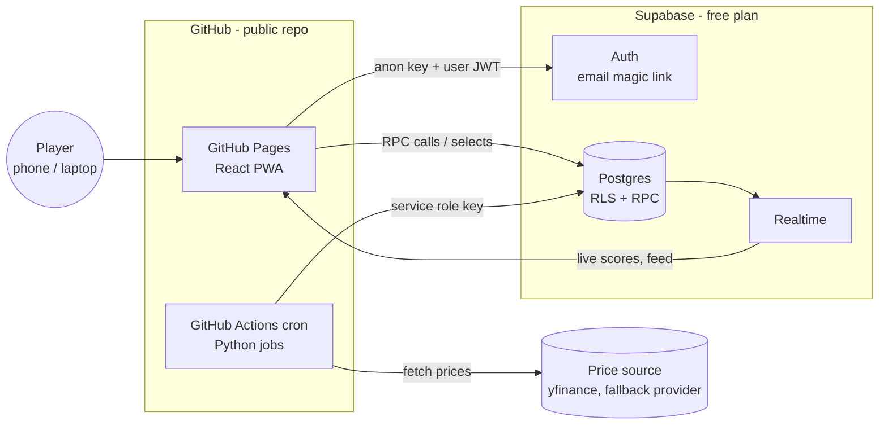
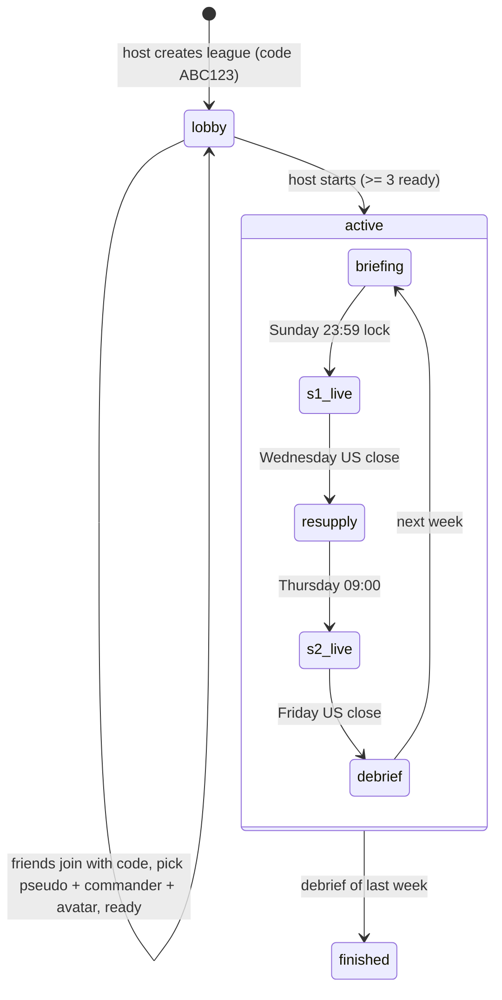

# ARCHITECTURE.md

## 1. Goals and constraints

- 3–5 friends per league, several leagues possible. UI in English and French, Europe/Paris time.
- Public GitHub repository, **zero running cost**, no server to maintain.
- Mobile-first: players mostly check on their phone (PWA, "add to home screen").
- Scores update every ~15 minutes during market hours. Not real-time trading.

## 2. Overview



| Piece | Choice | Why |
|---|---|---|
| Frontend | Vite + React + TS, PWA, GitHub Pages | Static hosting is free; Pages deploys from Actions |
| Auth + DB + realtime | Supabase (free plan) | Postgres with RLS, magic-link auth and realtime in one free service |
| Scheduled work | GitHub Actions cron | Free for public repos on standard runners; Python ecosystem for market data |
| Game maths | Python `engine/` package | One tested implementation, used by jobs and the replay tool |

### Platform facts to design around (checked Oct 2026)

- GitHub Actions is free for public repositories on standard GitHub-hosted runners.
- In a public repo, **scheduled workflows are disabled after 60 days without repository
  activity**. A campaign lasts up to 10 weeks → add a weekly `heartbeat` workflow that
  commits `status/heartbeat.json` (timestamp only, no league data).
- Scheduled runs can start late under load. The tick is time-based and idempotent; every
  workflow also has `workflow_dispatch` for manual runs.
- Supabase free projects are **paused after ~7 days of low database activity**. The tick
  writes to the database every 15 minutes on weekdays, which keeps it active; a weekend
  ping in the hourly weekend tick covers the gap.

## 3. Repository layout

```
.
├── CLAUDE.md
├── docs/                  GAME_RULES.md, ARCHITECTURE.md
├── data/instruments.csv   catalogue seed
├── web/                   React PWA
│   └── src/{app,pages,components,lib,i18n,config.ts}
├── supabase/
│   ├── migrations/        schema, RLS, RPC (SQL)
│   ├── seed.sql           instruments, game_config
│   └── tests/             RLS / RPC tests (pgTAP or SQL scripts)
├── engine/                Python package: pure game logic + calendars
│   ├── engine/{config,models,scoring,commanders,orders,ranking,feats,calendar,conflict_zone,drone}.py
│   └── tests/
├── jobs/                  tick.py, prices.py, replay.py, communique.py, db.py
├── status/heartbeat.json
└── .github/workflows/     ci.yml, deploy-pages.yml, tick.yml, heartbeat.yml
```

## 4. Data model (Postgres)

Enums: `league_status(lobby, active, finished)`,
`phase(briefing, s1_live, resupply, s2_live, debrief)`,
`slot(champion, veteran, marksman, saboteur, priority_target, reserve_1, reserve_2, reserve_3)`,
`commander(bastion, berserker, prophet, hunter, shadow, technomancer, quartermaster)`,
`order_type(...)`, `order_status(pending, applied, blocked, rejected)`.

| Table | Key columns |
|---|---|
| `profiles` | `id` (= auth.users.id), `locale` (`en`/`fr`), `created_at` |
| `leagues` | `id`, `name`, `invite_code` unique, `host_id`, `status`, `max_players` 3–5, `campaign_weeks`, `drone_enabled`, `start_week` (Monday date) |
| `league_members` | (`league_id`, `user_id`) pk, `pseudo`, `commander`, `avatar_color`, `ready`, `is_drone` |
| `instruments` | `id`, `ticker`, `name`, `region`, `calendar_mic`, `currency`, `sector` |
| `instrument_weeks` | (`instrument_id`, `week`), `vol12w`, `coef`, `display_class`, `prev_week_return`, `in_conflict_zone`, `earnings_date` |
| `reference_prices` | (`instrument_id`, `week`, `kind` p0/p_mid/p_end), `price`, `dividend`, `split_ratio`, `source`, `fetched_at` |
| `prices_live` | (`instrument_id`, `ts`), `price` — pruned after 14 days |
| `weeks` | (`league_id`, `week`), `number`, `phase`, `is_final`, `phase_changed_at` |
| `squads` | (`league_id`, `week`, `user_id`), `locked`, `auto`, `submitted_at` |
| `squad_units` | (`league_id`, `week`, `user_id`, `slot`), `instrument_id`, `active_s1`, `active_s2` |
| `ammo_ledger` | `league_id`, `user_id`, `week`, `delta`, `reason` (view `ammo_balance`) |
| `orders` | `id`, `league_id`, `week`, `player_id`, `type`, `target_user_id`, `target_slot`, `window`, `cost`, `status`, `created_at` |
| `pacts` | `league_id`, `week`, `a`, `b`, `status` (proposed, active) |
| `scores_live` | (`league_id`, `week`, `user_id`), `pf_live`, `rank_live`, `units` jsonb, `updated_at` |
| `scores_final` | (`league_id`, `week`, `user_id`), `pf_total`, `breakdown` jsonb, `rank`, `campaign_points` |
| `badges` | `league_id`, `week`, `user_id`, `code` |
| `events` | `id`, `league_id`, `week`, `ts`, `kind`, `template_key`, `vars` jsonb, `variant`, `audience` (all / user id) — rendered client-side in the reader's language |
| `game_config` | key/value mirror of `engine/config.py` for display |
| `job_runs` | unique (`league_id`, `week`, `transition`), `ran_at` — idempotence |

## 5. Security model (public repo)

**Clients have no INSERT/UPDATE/DELETE on any game table.** All writes go through RPC
functions (`security definer`, `search_path` pinned) that check auth, membership, phase,
deadlines and game rules, then write.

RPC functions: `create_league`, `join_league(code)`, `update_member(pseudo, commander, avatar_color)`,
`set_ready`, `start_campaign`, `save_squad(units jsonb)`, `swap_unit`, `play_order`,
`propose_pact`, `accept_pact`.

Read rules (RLS or `security_barrier` views):

| Data | Who can read |
|---|---|
| League, members, weeks, final scores, badges | Members of that league |
| Own squad, own orders, own ammo | Owner, always |
| Other players' squads | Members, from lock (`s1_live`). Shadow's squad: only from `debrief` |
| Other players' S2 swaps | From `s2_live`. Shadow: from `debrief` |
| Other players' orders | After resolution, via view `orders_public`: attacker masked when the attacker is a Shadow; `force_field` visible only once triggered |
| `scores_live` | Members; Shadow rows hidden from others; jammed rows return `pf_live = null` |
| `events` | Members, filtered by `audience` |
| `instruments`, prices, `game_config` | Any authenticated user |

Tests must prove each line of this table with two users and a third outsider.

Secrets: GitHub Actions secrets `SUPABASE_URL`, `SUPABASE_SERVICE_ROLE_KEY`. Frontend build
variables `VITE_SUPABASE_URL`, `VITE_SUPABASE_ANON_KEY` (public by design) as repository
variables. Supabase Auth redirect URL = the Pages URL.

## 6. Jobs and schedules

`jobs/tick.py` is the single entry point. It loads all active leagues, computes the phase
each week should be in **now** from the calendars, and performs any missing transition
(guarded by `job_runs`):

| Transition | When | Work |
|---|---|---|
| `open_briefing` | After debrief / at start | Ammo income + catch-up, Bounty, Conflict Zone, coefs |
| `lock` | Sunday 23:59:59 Paris | Lock squads, auto-squads, resolve briefing orders, Drone squad |
| `capture_p0` | First open of the week + 10 min, per calendar | Store `P0` |
| `open_resupply` | Wednesday US close + 5 min | Phase change |
| `close_resupply` | Thursday 08:59:59 | Apply swaps, resolve resupply orders |
| `capture_p_mid` | First open on/after Thursday + 10 min | Store `P_mid` |
| `live_scores` | Every tick during sessions | Update `scores_live` from `prices_live` |
| `debrief` | Friday US close + 5 min (once all `P_end` exist) | Final scoring, ranks, campaign points, feats, badges, Front Dispatch |
| `dispatch_*` | Monday open + 10 min, Thursday 09:10, debrief | Generate dispatch events (template key + vars) |

Workflows:

- `tick.yml`: `*/15` UTC on weekdays 06:00–22:00, hourly on weekends, plus `workflow_dispatch`.
  `concurrency: tick` so two runs never overlap.
- `heartbeat.yml`: weekly commit of `status/heartbeat.json`.
- `ci.yml`: ruff, pytest, eslint, vitest, build on every PR.
- `deploy-pages.yml`: build `web/` and deploy on push to `main`.

**Price source**: `yfinance` batch download for the 100 tickers in one call (live prices)
and daily bars for official open/close, dividends and splits. Wrap it behind a
`PriceProvider` interface so a fallback (e.g. a Google Sheets `GOOGLEFINANCE` CSV) can be
swapped in. Never let a provider failure corrupt reference prices: retry, then mark missing.

## 7. Lobby and game flow



Join link format: `https://<user>.github.io/<repo>/#/join/ABC123`.

## 8. Screens (EN/FR, light theme, mobile-first)

Routes are in English for both languages. A language switch sits in the header.

| Route | Screen |
|---|---|
| `#/` | My leagues + create / join |
| `#/login` | Magic-link login |
| `#/join/:code` | Join a league |
| `#/l/:id/lobby` | Lobby: players, commander, avatar, ready, start |
| `#/l/:id/briefing` | Squad builder, Conflict Zone, briefing orders, pacts |
| `#/l/:id/front` | Live leaderboard, my squad, daily phase, event feed |
| `#/l/:id/resupply` | Swap, resupply orders, ammo |
| `#/l/:id/debrief/:week` | Weekly ranking, feats, badges, Front Dispatch |
| `#/l/:id/campaign` | Campaign standings, history |
| `#/rules` | Rules and glossary |

## 9. Testing strategy

- `engine/`: unit tests for every formula and every edge case in GAME_RULES §12, plus
  golden weeks (fixed price fixtures → expected breakdown JSON).
- `supabase/tests`: RLS matrix of §5 and every RPC validation path.
- `jobs/replay.py`: replays a past week on historical daily bars with a fake clock against a
  dev Supabase project, so a full week can be played in minutes.
- `web/`: vitest for components with logic, one Playwright smoke test (login → join → squad).
